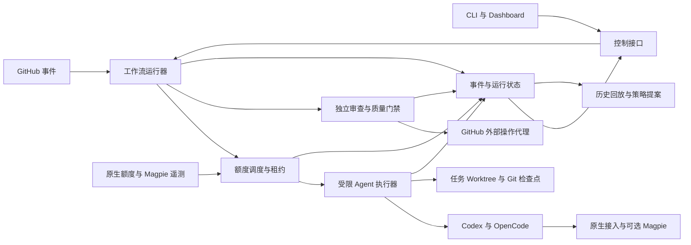

# QuotaFlow 架构建议

## 模块与数据流

工作流运行器推进节点，额度调度器选择合规的执行资源，受限执行器拥有任务写入和进程生命周期。GitHub 外部操作代理持有仓库凭据，依据门禁执行推送、更新 Draft PR 或其他已授权操作。仓库命令和业务规则来自项目配置，mcarplay 的 Android 与车机知识保存在项目级知识库。

单机 CLI 和服务共用领域逻辑。Phase 0 验证 TypeScript、Bun 和本地 SQLite 的候选组合，初期按单主机部署。SQLite 的工作库、Git 对象库及工作区放在本地文件系统，开启 WAL 前验证底层版本和崩溃恢复。[SQLite WAL 说明](https://www.sqlite.org/wal.html)

Agent Adapter 提供创建、执行、原生恢复和取消会话的操作，并返回能力、执行状态、结构化结果、错误分类、日志和用量。任务工作目录及权限由执行器传入。额度或实际模型由可用的原生事件与网关遥测补充，适配器声明各自可提供的能力。中立检查点使用平台格式，Agent 原生 Session ID 作为可选引用。

## 调度与额度归属

| 对象 | 含义 |
| --- | --- |
| Agent | 执行引擎及运行契约，含工具、权限、取消和原生恢复能力 |
| Model | 模型标识及能力，包括上下文、工具调用、任务效果和版本 |
| Provider | 提供模型或额度数据的服务，记录健康、调用方式和错误分类 |
| Account | 可授权消费的账户或密钥引用，记录实际计费主体和并发范围 |
| Quota Window | 某计量主体的带单位窗口，记录来源、观测时间、限额、剩余量、重置时间及数据状态 |

1. **筛选。** 按任务角色、项目权限、模型能力、Provider 健康、预算、并发及保留额度排除候选。兼容本地、原生订阅、网关和直接 API。对关键审查资源设最低能力，只有符合约束的候选可执行。
2. **排序。** 用确定性规则支持固定优先级、额度、成本、能力及混合策略。记录任务优先级、历史表现、会话连续性、预估消耗与切换成本，保留命中约束、分项得分和策略版本。历史权重调整经过 Phase 4 的回放与评估。
3. **预留。** 在事务中同时占有执行槽位、账户额度窗口和预算。用能够证实属于同一计费主体的标识合并原生与网关观测，避免把同份额度当成两份。核销时记录模型与账户的实际归属；证据尚未确定的消费保留预算占位，待对账后释放或核销。
4. **等待与恢复。** 分类处理额度耗尽、临时限流、供应商故障、认证失效与过程错误。按重置时间、退避与抖动、熔断探测安排下一次尝试。等待项释放执行槽位，其他合规任务继续推进。抢占限于安全检查点，并按已发生用量结算。

每项遥测区分上游观测、策略估算与 `UNKNOWN`，并记录授权范围。额度过期或归属不明时，关键任务等待；项目策略可以允许已授权、受限并发且新增成本可确认的低风险通道继续执行。额外 API 的默认预算为 0，成本状态不明的付费通道需要授权才可参与调度。

开发、复杂开发、架构、审查、安全审查、测试、调研、文档与进化角色通过配置绑定资源池。安全审查以授权仓库的代码和依赖分析为范围，审查发现进入相同的证据与修复流程。

## 跨 Agent 检查点与进程恢复

1. **停止并确认。** 当前尝试记录中断原因，取消执行并等待进程退出；到达超时后由受信任的进程管理器终止任务进程树。用进程身份和工作区权限确认旧尝试失去写能力。工作区写租约到期后先回收旧进程，结束状态无法确认时把任务标为 `blocked` 并隔离该工作区。
2. **快照和交接。** 记录待执行的检查点操作，在只对控制面可写的 Git 对象库中保存当前代码与允许路径内的工作区差异，覆盖已暂存、未暂存、删除和未跟踪文件，再确认私有检查点引用和产物已落盘。交接保存 Task、Repository、Issue／PR、基线与当前 SHA、Worktree、工作流节点、已完成与待完成项、修改文件和 Diff、测试结果、已知错误、决策、审查发现、Agent 与实际模型、原生 Session ID、尝试记录和中断原因。遇到被拒绝路径或无法安全保存的文件时记录状态并暂停交接。
3. **接管。** 调度器取得新的资源租约和递增的写入令牌，将旧工作成果的快照恢复到任务 Worktree 并校验树哈希。兼容的原 Agent 优先使用原生会话恢复。跨 Agent 启动新会话，由新 Agent 读取结构化交接、复核 Git 差异和测试基线，再完成余下任务。
4. **对账。** 任务状态和事件按事务更新。Git 与数据库各自落盘，恢复时依据持久化意图、检查点引用及哈希完成对账。GitHub 写操作先登记稳定的操作键，以仓库、任务和稳定分支标识查找既有 PR，并在重试前读远端确认。凭据和未脱敏日志由控制面隔离存放。

Git Worktree 管理任务分支与代码快照，操作系统进程隔离和访问控制负责限制权限。任务执行环境只获得已批准的路径和网络目的地；共享 Git 元数据和控制面状态库由受信进程管理。隔离能力需要在首个部署平台上验证后才允许系统处理真实仓库任务。

GitHub 入口校验签名、仓库范围和重复投递。控制面拒绝任务自行执行的受保护分支强推、生产数据删除和凭据导出；生产发布、正式 APK 签名、核心权限或质量门禁变更使用独立授权和人工批准。审计记录脱敏后的操作、结果、权限决策和主体。

## 工作流、质量门禁与进化

- 版本化 YAML 保存工作流、项目策略和节点参数的运行版本。基础 DAG 处理顺序与并行，条件、循环和子工作流由显式节点控制。任务依赖、定时与 Webhook、人工批准、重试、备用 Agent 和超时均保留状态与事件。
- 任务状态使用 `pending`、`planning`、`running`、`testing`、`reviewing`、`fixing`、`waiting_quota`、`waiting_dependency`、`waiting_human`、`blocked`、`completed`、`failed`、`cancelled`。一次任务可以包含多次 Agent 尝试。事件保留任务、实现版本、节点、尝试、提交、模型归属、结果及操作主体，供 CLI、Dashboard 和回放使用。
- Reviewer 使用只读代码视图。发现记录 ID、严重度、文件位置、触发条件、影响、证据、修复建议、置信度和审查 SHA。Fixer 修复后重跑测试，Reviewer 对新 SHA 重新审查。门禁核验当前 PR HEAD 的 P0 至 P2 均解决、必要回归通过及 GitHub 必需检查通过，并遵守仓库的分支保护与 Merge Queue 规则。轮数、预算或停滞达到上限时升级人工处理。关键任务可配置多模型独立审查和争议裁决。
- GitHub Actions 失败先归类为代码、执行环境或基础设施。仅对明确可重试的基础设施失败进行限次重试，对代码改动重跑受影响的回归并锁定新提交；以日志与 SHA 记录依据。Agent 读取的 Issue、PR、代码与日志均作为不可信输入处理。
- 每阶段记录经过验证的任务结果。模型画像按任务难度、模型版本和样本量分层。知识、Skills、测试、审查规则与工作流策略以版本化提案进入回放和影子评估，保留来源、验证状态、有效期和回滚版本。权限、预算与合并门禁的改动由审批策略控制。
